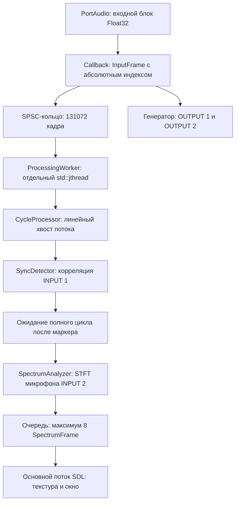
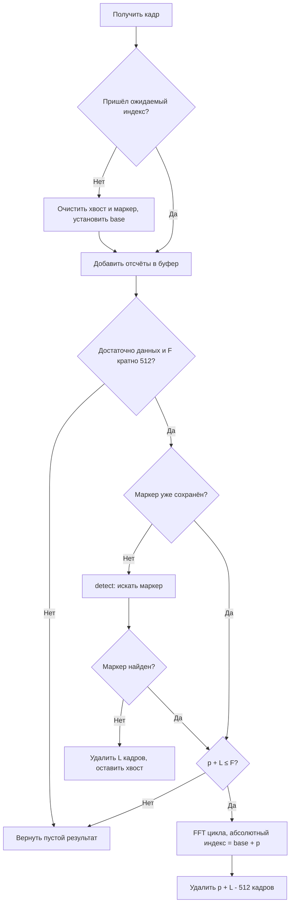

# Вычислительный тракт Acoustic Radar

Здесь описано, как программа получает четырёхканальный звук, находит начало цикла и строит спектрограмму. Для каждого этапа указаны буферы, единицы измерения и формулы пересчёта индексов. Описание соответствует текущему коду; его ограничения вынесены в последний раздел.

Практические команды сборки, подключение оборудования и управление приведены в [README](../README.md).

## Содержание

1. [Обозначения и единицы](#1-обозначения-и-единицы)
2. [Потоки и путь данных](#2-потоки-и-путь-данных)
3. [Формирование возбуждения](#3-формирование-возбуждения)
4. [Входные кадры и абсолютное время](#4-входные-кадры-и-абсолютное-время)
5. [Кольцевой буфер SPSC](#5-кольцевой-буфер-spsc)
6. [Линейный буфер и сборка циклов](#6-линейный-буфер-и-сборка-циклов)
7. [Корреляционный поиск маркера](#7-корреляционный-поиск-маркера)
8. [Сквозной пример индексов](#8-сквозной-пример-индексов)
9. [STFT и FFT](#9-stft-и-fft)
10. [Спектр, амплитуда и dBFS](#10-спектр-амплитуда-и-dbfs)
11. [От спектра к пикселям](#11-от-спектра-к-пикселям)
12. [Память, очередь результатов и остановка](#12-память-очередь-результатов-и-остановка)
13. [Проверки и известные ограничения](#13-проверки-и-известные-ограничения)

## 1. Обозначения и единицы

| Обозначение | Значение | Единица / смысл |
| --- | --- | --- |
| `Fs` | 48000 | Частота дискретизации, кадров/с на входе |
| `C` | 4 | Число входных каналов |
| `L` | 48000 | Длина цикла, аудиокадров; 1000 мс |
| `M` | 480 | Длина синхромаркера, отсчётов одного канала; 10 мс |
| `B` | 512 | Запрошенный размер блока PortAudio, кадров |
| `Q` | 131072 | Ёмкость кольцевого буфера, структур `InputFrame` |
| `N` | 4096 | Размер FFT и измерительного окна, отсчётов одного канала |
| `H` | 1024 | Сдвиг соседних окон STFT, кадров |
| `R` | 512 | Радиус поиска последующих маркеров в пакетном детекторе, кадров |
| `base` | Меняется | Абсолютный индекс первого кадра линейного буфера |
| `p` | Меняется | Локальный индекс маркера относительно линейного буфера |
| `o` | `0, H, 2H, …` | Смещение начала окна FFT относительно маркера |
| `j` | `0…N−1` | Отсчёт внутри одного окна FFT |
| `b` | `0…N/2` | Индекс частотного бина |

**Отсчёт** — одно число одного канала. **Аудиокадр** — набор одновременных отсчётов всех каналов. При четырёх входах 512 аудиокадров содержат 2048 чисел `float`, но охватывают только `512 / 48000 = 10,67 мс`, а не 42,67 мс.

**Спектральный кадр** `SpectrumFrame` — результат анализа целого цикла. Он содержит несколько спектров, каждый из которых отображается одним столбцом графика. Его не следует путать с аудиокадром из четырёх отсчётов.

Число 512 используется в нескольких независимых настройках: размер аудиоблока, период проверки сборщика, радиус пакетного поиска и длина сохраняемого запаса перед следующим маркером. Их совпадение не означает, что это одна настройка. Шаг FFT равен **1024**, а её размер — **4096**.

Во всех формулах интервал `[a, b)` включает `a`, но не включает `b`. Диапазоны стартовых позиций корреляции `[first, last]`, напротив, включают обе границы — так написан цикл `position <= last`.

## 2. Потоки и путь данных



Начало блока PortAudio не считается началом возбуждения. Блок может начинаться посреди маркера, посреди chirp или во время паузы. Сборщик последовательно восстанавливает поток, а детектор определяет положение маркера по его форме.

Callback — функция, которую PortAudio вызывает для очередного блока звука. Она не вычисляет FFT и корреляцию, не захватывает мьютекс очереди результатов и не обращается к файлам. Рабочий поток может выделять память и выполнять длительные вычисления. SDL вызывается только основным потоком.

Основные исходники:

- [audio.cpp](../src/audio.cpp) — вход, выход, статистика;
- [ring.hpp](../include/acoustic_radar/ring.hpp) — передача кадров;
- [processing.cpp](../src/processing.cpp) — накопление и выделение циклов;
- [sync.cpp](../src/sync.cpp) — поиск синхромаркера;
- [spectrum.cpp](../src/spectrum.cpp) — FFT и амплитуды;
- [visualization.cpp](../src/visualization.cpp) — накопление изображения.

## 3. Формирование возбуждения

`ChirpGenerator::nextSample()` возвращает один стереокадр. Счётчик генератора увеличивается на единицу при каждом вызове:

```text
position = sampleIndex % L
localTime = position / Fs
```

В начале каждого секундного цикла одновременно начинаются:

- левый синхромаркер 8–12 кГц, 10 мс, амплитуда 0,1;
- правое возбуждение, по умолчанию 1900–2900 Гц, 250 мс, амплитуда 0,5.

Оставшееся время каждый канал выдаёт нули. По умолчанию у правого выхода остаётся 750 мс паузы для наблюдения затухания.

### 3.1. Почему вычисляется фаза

Для линейного изменения частоты:

```text
k = (f1 - f0) / T                       [Гц/с]
f(t) = f0 + k*t                         [Гц]
phase(t) = 2*pi*(f0*t + k*t*t/2)         [радианы]
signal(t) = amplitude * envelope(t) * sin(phase(t))
```

Фаза накапливает изменения частоты во времени: это интеграл мгновенной частоты, умноженный на `2*pi`. Простая подстановка `sin(2*pi*f(t)*t)` не эквивалентна этой формуле: производная её фазы дала бы `f0 + 2*k*t`.

### 3.2. Огибающие

Синхромаркер умножается на симметричное окно Ханна длиной `M`:

```text
w(n) = 0.5 * (1 - cos(2*pi*n/(M-1)))
```

Оба края имеют нулевую амплитуду. Такой же маркер создаётся для корреляционного эталона.

Акустическое возбуждение имеет косинусное нарастание за 10 мс, участок полного уровня и косинусный спад за последние 10 мс. Это другая огибающая: окно Ханна не растягивается на всю длительность акустического chirp.

### 3.3. Изменение настроек

Нижняя частота и длительность записываются в одну атомарную переменную. Частота занимает старшие 32 бита, длительность — младшие:

```text
packed = (uint64_t(startHz) << 32) | durationMs
```

Аудиопоток читает пару только при `position == 0`. Параметры текущего цикла не меняются посреди генерации. `memory_order_relaxed` достаточно: атомарная операция передаёт сразу оба числа, а синхронизировать с ними другие данные не требуется.

Счётчик генератора и индекс входа существуют отдельно. Даже при общем callback нельзя считать момент генерации фактически принятой позицией: есть задержка аудиотракта. Начало графика определяется входной корреляцией.

## 4. Входные кадры и абсолютное время

PortAudio передаёт вход с чередованием каналов:

```text
Кадр 0: input[0] input[1] input[2] input[3]
Кадр 1: input[4] input[5] input[6] input[7]
Кадр 2: input[8] input[9] input[10] input[11]
```

Адрес отсчёта канала `c` в локальном кадре `i`:

```text
floatIndex = i*C + c
```

Это номер элемента массива. Его нельзя использовать как смещение в байтах. Байтовое смещение равно `floatIndex * sizeof(float)`.

В начале callback читается число ранее обработанных входных кадров `firstIndex`. Для каждого кадра блока создаётся:

```text
InputFrame.index = firstIndex + i
InputFrame.samples[c] = input[i*C + c]
```

После обработки всего блока счётчик увеличивается на `frameCount`. Используется фактический аргумент `frameCount`, а не предположение о неизменных 512 кадрах.

Если входной указатель пустой, вместо его разыменования передаются четыре нуля. Если кольцо заполнено, текущий `InputFrame` не попадает в обработчик, но счётчик исходного потока всё равно продвигается.

Например, после принятого индекса 1000 могут быть отброшены 1001–1199. Следующий полученный кадр с индексом 1200 позволяет заметить разрыв. Счётчик записи кольца при отказе не увеличивается. По нему нельзя определить, сколько входных кадров было пропущено.

`index / Fs` — время, вычисленное по числу кадров, которые обработал callback. Это не аппаратная временная метка. Флаг `paInputOverflow` показывает возможную потерю внутри PortAudio/драйвера, но программа не знает её точную длину и не восстанавливает её через `index`.

## 5. Кольцевой буфер SPSC

SPSC (Single Producer, Single Consumer) означает «один производитель и один потребитель»: один поток записывает данные, другой их читает. Очередь сохраняет порядок FIFO (First In, First Out) — первым читается тот элемент, который был записан раньше остальных.

### 5.1. Два счётчика и массив

`SpscRing<InputFrame, 131072>` имеет массив фиксированной ёмкости и два атомарных счётчика:

```text
write = число успешно записанных элементов
read  = число прочитанных элементов
used  = write - read
slot  = counter % Q
```

Состояния:

```text
write == read          → пусто
write - read == Q      → полно
0 < write - read < Q   → есть данные и свободное место
```

Не требуется оставлять одну ячейку пустой: состояния различаются по счётчикам, а не только по физическим позициям.

Иллюстрация с ёмкостью 4:

| Действие | `read` | `write` | Содержимое по порядку чтения |
| --- | --- | --- | --- |
| Начальное состояние | 0 | 0 | Пусто |
| Записать A, B, C, D | 0 | 4 | A, B, C, D |
| Попытаться записать E | 0 | 4 | Отказ, A–D сохраняются |
| Прочитать A, B | 2 | 4 | C, D |
| Записать E, F | 2 | 6 | C, D, E, F |

E и F занимают ячейки массива 0 и 1, но записываются при значениях `write` 4 и 5. Поэтому переход к началу массива не меняет порядок чтения.

### 5.2. Как передать данные без одновременного чтения и записи

Производитель:

1. Читает свой `write_` с `relaxed`.
2. Читает `read_` с `acquire`, проверяет свободное место.
3. Записывает обычную структуру в `data_[write % Q]`.
4. Публикует новый `write_` с `release`.

Потребитель:

1. Читает свой `read_` с `relaxed`.
2. Читает `write_` с `acquire`, проверяет наличие элемента.
3. Копирует обычную структуру из `data_[read % Q]`.
4. Публикует новый `read_` с `release`, разрешая повторное использование ячейки.

Запись индекса с `release` и чтение с `acquire` связывают обновление индекса с доступом к данным. Если поток чтения увидел новый `write_`, он видит и полностью записанный элемент. Если поток записи увидел новый `read_`, чтение элемента уже закончено и ячейку можно заполнить заново. Поэтому обычные поля `InputFrame`, включая `float`, не обязаны быть атомарными.

Контракт требует **ровно одного** производителя и **ровно одного** потребителя. Два потока записи или чтения сделали бы эту схему некорректной. `is_always_lock_free` проверяется при компиляции. Выравнивание на 64 байта разносит индексы чтения и записи по разным строкам кэша на типичных процессорах. Поэтому их обновление разными потоками реже вызывает лишний обмен данными между ядрами. Правильность передачи при этом обеспечивают атомарные операции, а не выравнивание.

### 5.3. Переполнение и запас времени

```text
Q / Fs = 131072 / 48000 ≈ 2.73 с
```

Это объём накопления непрочитанных кадров, не целевая задержка. В норме обработчик читает кольцо почти сразу.

При заполнении callback отбрасывает новые кадры и увеличивает `droppedInputFrames`. Он не ждёт потребителя, чтобы задержка анализа не останавливала вывод звука. Когда место появляется, новые кадры снова принимаются; разрыв их абсолютных индексов сбрасывает незавершённый анализ.

Кольцо создаётся до старта аудио и размещается в динамической памяти. При типичном `sizeof(InputFrame) == 24` сам массив занимает 3 МиБ: в каждом элементе есть не только четыре `float`, но и индекс и возможное выравнивание.

При достижении максимума `uint64_t` следующий индекс станет нулём. Рабочая ёмкость 131072 делит `2^64` без остатка, поэтому порядок ячеек при этом сохранится. Для других ёмкостей это не гарантируется. Обычный переход от конца массива к началу через `% Q` работает независимо от переполнения самого счётчика.

## 6. Линейный буфер и сборка циклов

Кольцо решает обмен между потоками. Для корреляции и FFT нужен другой буфер: последовательный участок звука с произвольным доступом к соседним отсчётам. Такой участок хранится в `CycleProcessor::samples_`.

### 6.1. Связь локального и абсолютного индексов

```text
F = samples_.size() / C
Локальный кадр k ↔ абсолютный кадр base_ + k
Отсчёт канала c ↔ samples_[k*C + c]
```

Здесь `base_` измеряется в исходных аудиокадрах. Это не индекс кольца, не число `float` и не количество обработанных циклов.

На первом кадре или после разрыва выполняются:

```text
samples_.clear()
pendingMarker_.reset()
base_ = incoming.index
nextIndex_ = incoming.index + 1
```

Четыре отсчёта нового кадра добавляются в конец массива. Если пропусков нет, его `incoming.index` равен ожидаемому `nextIndex_`.

### 6.2. Когда запускается проверка

После добавления каждого кадра проверяются два условия:

```text
F >= L + M
F % 512 == 0
```

При текущих параметрах `L+M = 48480`. Первое кратное 512 число не меньше этого порога — **48640**.

После первого периода дополнительно накапливаются `M` кадров. Благодаря этому маркер, начавшийся в конце периода, целиком помещается в буфер. Проверка выполняется только после накопления ещё одной порции данных. Сам маркер может находиться в любой позиции, не обязательно кратной 512. Это число также не задаёт шаг FFT. После удаления начала буфера проверяется кратность **его нового размера**, а не абсолютного индекса входного кадра.

### 6.3. Состояния сборщика



На схеме показаны основные решения. Прежде чем добавить отсчёты, код проверяет индекс и при необходимости сбрасывает старые данные.

Если маркер ещё не найден, вызывается `SyncDetector::detect()`. Из возвращённого вектора сборщик берёт **только первый элемент**. В живом режиме остальные элементы этого списка не используются. В режиме просмотра WAV программа обрабатывает весь список.

Найденная позиция сохраняется в `pendingMarker_`. Пока данных после неё меньше `L`, буфер не сдвигается. Поэтому сохранённый индекс продолжает указывать на тот же маркер. Повторно искать его при каждом добавлении данных не требуется.

### 6.4. Удаление начала буфера, если маркер не найден

Если начальное совпадение не найдено:

```text
discard = L
samples_.erase(first discard*C float-элементов)
base_ += discard
```

При первом размере 48640 останется 640 кадров. Это не всегда ровно `M` кадров: размер зависит от шага проверки и ранее сохранённого хвоста. Важно, что хвост остаётся, и маркер на границе поисковых интервалов не теряется из-за простого обнуления всего буфера.

Следующий поиск будет относиться к более позднему участку исходного потока. Даже если в начале сигнала тишина длиннее периода, программа продолжит поиск и сможет найти маркер позже.

### 6.5. Удаление начала буфера после анализа цикла

Цикл готов, когда:

```text
p + L <= F
```

Анализируются `L` кадров, начиная с `p`: от `p` до `p+L−1` включительно. Затем:

```text
discard = p + L - 512
base_new = base_old + discard
F_new = F_old - discard
```

Почему вычитается 512? Следующий маркер ожидается примерно в `p+L`. После удаления он окажется около локальной позиции:

```text
(p + L) - (p + L - 512) = 512
```

Оставленные 512 кадров перед ожидаемой позицией позволяют принять немного более ранний маркер. Это запас перед новым поиском, а не сохранение целого предыдущего возбуждения.

`pendingMarker_` сбрасывается. Начало следующего цикла снова определяется по входному маркеру. Программа не делит поток на равные части без проверки синхронизации.

`vector::erase` удаляет начало массива и сдвигает оставшиеся данные. Эта работа выполняется в рабочем потоке, поэтому не задерживает callback напрямую. Ёмкость вектора после удаления может оставаться больше его размера, но не растёт пропорционально продолжительности сессии.

## 7. Корреляционный поиск маркера

### 7.1. Эталон

`makeReference()` создаёт `ChirpGenerator` и берёт первые `M` значений левого выхода. Эталон включает частотную развёртку и окно Ханна. Он не содержит правого акустического возбуждения.

Проверяя, не начинается ли маркер в позиции `p`, детектор берёт следующие отсчёты:

```text
x_p[j] = input[(p+j)*C + 0],   j = 0…M−1
s[j] = reference[j]
```

### 7.2. Нормированная оценка

Для каждого сдвига вычисляются:

```text
dot = Σ x_p[j] * s[j]
Ex  = Σ x_p[j]^2
Es  = Σ s[j]^2
r(p) = dot / sqrt(Ex*Es)
```

Суммы берутся по `j=0…M−1`. Чтобы получить оценку, скалярное произведение двух наборов отсчётов делят на произведение их длин. Её также называют косинусным сходством. В отличие от коэффициента корреляции Пирсона, здесь из отсчётов не вычитается их среднее значение.

Если `x_p = a*s` при положительном `a`, то числитель и знаменатель масштабируются одинаково, и оценка близка к 1. Простое изменение усиления поэтому почти не меняет оценку, пока сигнал не стал слишком тихим или перегруженным.

При отрицательном `a` оценка близка к −1. Детектор сравнивает с порогом само значение корреляции, а не его модуль. Поэтому маркер с обратной полярностью не принимается.

Шум, постоянное смещение и изменение формы сигнала уменьшают сходство. Само значение `r` не является вероятностью, уровнем в dBFS или оценкой громкости.

### 7.3. Выбор пика и порог

```text
Если Ex < 1e-12: окно пропускается.
Лучший кандидат: наибольшее r(p) во всём поисковом диапазоне.
Принимается, если best.r >= 0.75.
```

Алгоритм проверяет все позиции в диапазоне и выбирает наилучшее совпадение. Он не останавливается на первой оценке выше порога. Если несколько оценок равны, выбирается более ранняя позиция: лучший результат обновляется только при `r > best.r`.

Энергия эталона считается один раз на вызов `findPeak`, энергия входного окна — заново для каждой позиции. Для каждой из `P` позиций код заново сравнивает `M` пар отсчётов. Число операций поэтому растёт примерно как `P*M`; FFT для ускорения корреляции здесь не используется. Во время начального поиска код сравнивает около 23 млн пар отсчётов: 48000 позиций по 480 отсчётов. Именно поэтому он не выполняется в callback.

### 7.4. Где ищется первый маркер

Начальные стартовые позиции:

```text
first = 0
last = L-1
maximumStart = F-M
```

Код ограничивает **обе** границы выражением `min(boundary, maximumStart)`. Поэтому при начальном поиске проверяются только позиции, для которых в буфере есть все `M` отсчётов эталона. Недостающие отсчёты не заменяются нулями.

Если начального пика нет, `detect()` сразу возвращает пустой вектор. Сам `detect()` не ищет дальше первого периода, если начального совпадения нет. `CycleProcessor` удаляет уже проверенные данные и вызывает детектор снова.

Если в первом периоде присутствуют несколько подходящих совпадений, выбирается наиболее сильное по корреляции, не обязательно первое по времени.

### 7.5. Где ищутся последующие маркеры

После первого найденного индекса `p0` пакетный детектор строит ожидания:

```text
expected(k) = p0 + k*L,   k = 1, 2, …
first(k) = max(0, expected(k)-R)
last(k) = expected(k)+R
```

Границы дополнительно ограничиваются доступными полными окнами внутри `findPeak`. Вход должен содержать целый эталон также в ожидаемой позиции; иначе внешний цикл поиска завершается.

Ожидаемые позиции вычисляются от первого маркера. Ошибка одного найденного пика не сдвигает следующие области поиска. Но если фактический период постепенно расходится с заданным, на длинной записи маркер может уйти дальше чем на ±512 кадров от ожидаемой позиции.

Если один промежуточный пик не прошёл порог, он не добавляется в вектор, но проверка следующего ожидаемого периода продолжается. Поэтому соседние результаты могут отстоять на два и более периода.

**Разница live и replay:** live-сборщик берёт один первый результат, обрабатывает цикл, передвигает хвост и заново захватывает маркер. Replay обходит возвращённый пакетный список по всей записи. Период записи автоматически не определяется.

## 8. Сквозной пример индексов

Пусть линейный буфер начинается с абсолютного кадра `base=100000`, а детектор нашёл маркер в локальном кадре `p=1253`.

```text
Абсолютный маркер = 100000 + 1253 = 101253
Цикл в локальном буфере: [1253, 49253)
Цикл в исходном потоке:  [101253, 149253)
```

Первый поиск возможен при `F=48640`, но полного цикла ещё нет: `49253 > 48640`. Позиция сохраняется. Следующая проверка при `F=49152` также недостаточна. При `F=49664` цикл готов.

### 8.1. Адреса отсчётов

Первое окно FFT имеет `o=0`. Первый отсчёт микрофона:

```text
Локальный кадр = p + o + j = 1253 + 0 + 0
Элемент samples_ = 1253*4 + 1 = 5013
Абсолютный входной кадр = base + p + o + j = 101253
```

Следующий микрофонный отсчёт (`j=1`) находится в `samples_[5017]`, не в `samples_[5014]`: между ними лежат отсчёты других каналов.

Для второго окна `o=1024` первый микрофонный элемент:

```text
(1253 + 1024)*4 + 1 = 9109
```

Его абсолютный кадр равен `102277`. Абсолютный индекс потока нельзя использовать непосредственно как индекс локального массива — сначала нужно вычесть `base`.

### 8.2. Временная координата первого столбца

```text
Локальный центр в буфере = p + o + N/2 = 3301
Абсолютный центр = base + 3301 = 103301
Время от маркера = (o + N/2)/Fs = 2048/48000 = 42.6667 мс
```

На графике не используются `103301/Fs` или `3301/Fs`. Из центра вычтено начало маркера, поэтому все циклы накладываются в общих относительных координатах.

### 8.3. Передвижение буфера

После анализа:

```text
discard = 1253 + 48000 - 512 = 48741 кадров
Удаляется 48741*4 = 194964 float-элемента
base_new = 100000 + 48741 = 148741
F_new = 49664 - 48741 = 923 кадра
```

Следующий маркер при идеальном периоде находится в абсолютном кадре `149253`. Его новая локальная позиция:

```text
149253 - 148741 = 512
```

Оставшиеся 923 кадра начинаются за 512 кадров до маркера и содержат 411 кадров после его начала. Это ещё не полный новый цикл — требуется дальнейшее накопление.

До и после удаления начала буфера действует одно правило: `base + localIndex` даёт индекс того же кадра в исходном потоке. Локальный индекс уменьшается ровно на столько, на сколько увеличивается `base`.

## 9. STFT и FFT

### 9.1. Зачем анализировать окна

Одна FFT всего секундного цикла показала бы его суммарный спектр, но потеряла бы информацию, когда частота появилась и как затухала. STFT — кратковременное преобразование Фурье — повторяет FFT по последовательным окнам.

Для окна со смещением `o`:

```text
x[j] = data[(p+o+j)*C + 1]
y[j] = x[j] * w[j],   j=0…N−1
```

Окно Ханна:

```text
w[j] = 0.5 * (1 - cos(2*pi*j/(N-1)))
```

При вычислении FFT выбранный фрагмент сигнала рассматривается как периодически повторяющийся. Если конец фрагмента не стыкуется с началом, при таком повторении возникает скачок. В спектре появляются лишние составляющие рядом с частотой сигнала. Окно сглаживает края и уменьшает боковые лепестки — слабые пики по сторонам от основного пика. Сам основной пик при этом становится шире. Поэтому два близких резонанса могут сливаться, даже если их частоты попадают в разные бины.

### 9.2. Комплексный спектр

FFTW вычисляет дискретное преобразование вещественного окна:

```text
X[b] = Σ y[j] * exp(-i*2*pi*b*j/N),   j=0…N−1
```

FFT — эффективный способ вычисления этой суммы для всех бинов с трудоёмкостью порядка `N*log(N)` вместо прямого расчёта порядка `N²`.

Каждый коэффициент содержит действительную и мнимую части. Его модуль:

```text
magnitude[b] = hypot(real(X[b]), imag(X[b]))
```

Угол комплексного коэффициента, который в математике называют аргументом, задаёт фазу. В текущую спектрограмму фаза не передаётся.

Для вещественного входа коэффициенты отрицательных частот имеют ту же действительную часть и противоположный знак мнимой части, что и соответствующие положительные частоты. Такие коэффициенты называют комплексно-сопряжёнными; они не дают дополнительной информации. `fftw_plan_dft_r2c_1d` поэтому возвращает только `N/2+1 = 2049` бинов.

### 9.3. Частота бина

Бин — один элемент массива спектра с определённой частотой. Номера бинов целые, поэтому FFT даёт значения на дискретной сетке частот, а не на любой произвольно выбранной частоте.

```text
frequency(b) = b * Fs / N
Δf = Fs / N = 11.71875 Гц
```

| Бин | Частота | Назначение |
| --- | --- | --- |
| 0 | 0 Гц | Постоянная составляющая |
| 100 | 1171,875 Гц | Тестовый тон `spectrum_test` |
| 163 | 1910,15625 Гц | Первый центр бина внутри полосы 1900–2900 Гц |
| 200 | 2343,75 Гц | Пример внутреннего бина |
| 247 | 2894,53125 Гц | Последний центр бина внутри исходной полосы |
| 2048 | 24000 Гц | Частота Найквиста |

Полоса 1900–2900 Гц не совпадает точно с сеткой FFT. Визуализация отбирает бины по частоте их **центра**, без интерполяции краевых значений или оценки дробного положения резонансного пика.

### 9.4. Временные позиции окон

```text
o(k) = k*H
Количество столбцов K = floor((L-N)/H) + 1
Время центра t(k) = (k*H + N/2)/Fs
```

При текущих параметрах `K=43`:

| Столбец `k` | Начало окна | Конец, не включая | Центр относительно маркера |
| --- | --- | --- | --- |
| 0 | 0 | 4096 | 42,6667 мс |
| 1 | 1024 | 5120 | 64 мс |
| 2 | 2048 | 6144 | 85,3333 мс |
| 42 | 43008 | 47104 | 938,6667 мс |

Окно 43 началось бы с 44032 и закончилось бы на 48128, то есть вышло бы за цикл. Поэтому его нет. Последние 896 кадров цикла не попадают ни в одно окно, а центры измерений не доходят до краёв оси.

Размер окна `N/Fs = 85,33 мс` — длительность участка сигнала, по которому вычисляется один спектр. Шаг `H/Fs = 21,33 мс` — интервал между соседними измерениями, примерно 46,875 измерения в секунду внутри последовательности окон. Эти оценки не независимы: 75% исходных отсчётов у соседних окон общие.

В коде координата середины окна выбрана как `N/2=2048`. Среднее первого и последнего индекса `0…4095` равно 2047,5. Разница составляет половину отсчёта и влияет только на подпись времени, не на вычисление FFT.

### 9.5. Повторное использование FFTW-плана

`SpectrumAnalyzer` один раз вычисляет окно и его сумму, создаёт план FFTW. Затем для каждого столбца:

1. Заполняет `input_` микрофонными отсчётами, умноженными на коэффициенты окна.
2. Вызывает `fftw_execute(plan_)`.
3. Читает комплексный `output_`, рассчитывает амплитуды и dBFS.
4. Копирует результат в независимый `SpectrumColumn`.

План FFTW — подготовленное описание того, как выполнить преобразование для заданного размера и рабочих массивов. Он связан с адресами этих массивов. Один анализатор не используется одновременно разными потоками, копирование объекта запрещено. При уничтожении освобождается его план, а массивы освобождаются как поля объекта. `FFTW_ESTIMATE` выбирает план без длительного перебора пробных исполнений.

## 10. Спектр, амплитуда и dBFS

FFTW вычисляет суммы без деления на размер окна или другие коэффициенты. Поэтому их модули ещё нужно привести к масштабу исходного сигнала. Для окна Ханна вычисляется:

```text
S = Σ w[j] = (N-1)/2 = 2047.5
scale(b) = 1, если b=0 или b=N/2; иначе 2
A[b] = scale(b) * magnitude[b] / S
D[b] = 20*log10(max(A[b], 1e-10))
```

Умножение на окно уменьшает амплитуду. Деление на сумму коэффициентов окна компенсирует это уменьшение. Удвоение внутренних положительных частот учитывает зеркальную отрицательную половину спектра. У DC и частоты Найквиста отдельной зеркальной пары нет.

Для синуса, частота которого совпадает с бином между нулём и частотой Найквиста, `A` приблизительно восстанавливает его **пиковую** амплитуду. Среднеквадратичная амплитуда (RMS) синуса равна пиковой, делённой на `sqrt(2)`. Здесь рассчитывается пиковая амплитуда, поэтому деления на `sqrt(2)` нет.

| Амплитуда `A` | Уровень |
| --- | --- |
| 1 | 0 dBFS |
| 0,5 | −6,0206 dBFS |
| 0,1 | −20 dBFS |
| 0,001 | −60 dBFS |
| 0 и значения ≤1e−10 | Нижний предел −200 dBFS |

Эти уровни описывают цифровой сигнал. Они не показывают акустическое давление в дБ SPL: чувствительность микрофона и усиление тракта здесь не учитываются. Также это не спектральная плотность мощности — мощность, приходящаяся на единицу полосы частот. Для широкополосного шума отдельный бин зависит также от размера FFT и полосы окна; нормировка для точного измерения мощности шума потребовала бы другого подхода.

Если частота лежит между бинами, энергия распределяется по нескольким коэффициентам. Максимум одного бина может недооценивать амплитуду, а его частота не даёт точной непрерывной частоты резонанса. Поиск и интерполяция резонансных пиков сейчас не реализованы: на график передаётся весь спектр.

## 11. От спектра к пикселям

### 11.1. Текстура и координаты

История хранится в текстуре шириной `W=1100` и высотой `V=540` пикселей. Новые спектры сначала рисуются в этой текстуре, затем она выводится в окно. При изменении размера окна готовая текстура масштабируется; FFT и история не пересчитываются.

Для нижней границы диапазона `fLow` и частоты бина `f`:

```text
u = (f - fLow) / 1000
centerX = W * t / CycleDuration
centerY = V * (1-u)
cellWidth = W * (H/Fs) / CycleDuration ≈ 23.47 пикселя
cellHeight = V * (Fs/N) / 1000 ≈ 6.33 пикселя
```

Вычитание `u` из единицы нужно потому, что экранная координата Y растёт вниз. Высокие частоты оказываются сверху.

Центр ячейки соответствует времени измерения и частоте бина. Её ширина соответствует **шагу** STFT, а не длине измерительного окна. Границы округляются к пикселям отдельно для каждой стороны, чтобы соседние ячейки не закрашивали стык дважды. Отрисовка всё же дискретна: размеры соседних прямоугольников могут отличаться на пиксель.

### 11.2. Палитра и уровень

Оттенок определяется только частотой:

```text
Красный → жёлтый → зелёный → голубой → синий
u=0       0.25     0.5       0.75      1
```

В коде это линейные участки RGB, соответствующие изменению оттенка HSV от 0° до 240°. Амплитуда задаёт коэффициент непрозрачности (alpha):

```text
alpha = clamp((D[b] + 80)/65, 0, 1)
```

Уровни ≤−80 dBFS не рисуются, ≥−15 dBFS наносятся непрозрачно. Alpha задаёт, насколько новая ячейка перекрывает старое изображение: 0 — не видна, 1 — полностью непрозрачна. Между −80 и −15 dBFS коэффициент растёт линейно по уровню в децибелах. Этот масштаб выбран для удобства просмотра, а не для измерения энергии.

### 11.3. История и затухание

Перед каждым непустым спектральным кадром на всю текстуру накладывается чёрный прямоугольник с alpha `102/255=0,4`:

```text
historyFaded = 0.6 * historyOld
pixelNew = alpha * frequencyColor + (1-alpha) * historyFaded
```

Вторая формула применяется в ячейках нового спектра. Это смешивание цветов изображения, а не усреднение комплексных спектров или физических мощностей.

Без повторного возбуждения того же участка вклад старого следа после `n` шагов затухания примерно равен `0,6^n`. Если новые кадры не поступают, `draw()` не уменьшает яркость. Если очередь удалила часть готовых кадров, для них не выполняется дополнительное затемнение. История меняется только при вызове `add()` с очередным показанным кадром.

Оси и подписи рисуются поверх текстуры в окно и не участвуют в накоплении. Линия длительности возбуждения показывает настройку UI, не найденную по входу границу сигнала.

## 12. Память, очередь результатов и остановка

### 12.1. Где хранятся данные и когда они освобождаются

| Объект | Содержимое | Поток / время жизни |
| --- | --- | --- |
| Входной указатель PortAudio | Текущий блок входа | Доступен callback; указатель не сохраняется |
| `AudioDevice::inputRing_` | Копии `InputFrame` | Один производитель и один потребитель |
| `CycleProcessor::samples_` | Непрерывный линейный хвост | Только рабочий поток |
| `pendingMarker_` | Локальная позиция и корреляция | Только рабочий поток, до завершения цикла или сброса |
| `SpectrumAnalyzer` | Окно, массивы FFT, план | Экземпляр рабочего потока |
| `SpectrumFrame` | Независимые спектральные столбцы | Переносится в очередь, затем в SDL-поток |
| `ready_` | До восьми готовых спектров | Под мьютексом рабочего и основного потоков |
| `accumulation_` | Изображение истории | Только основной SDL-поток |

Готовые спектры не содержат указателей на исходный звуковой буфер. После выдачи `SpectrumFrame` локальный аудиобуфер можно сдвигать и пополнять.

При текущем алгоритме локальный буфер хранит примерно один–два цикла: найденный первый маркер находится в первом периоде, а далее нужен ещё один период после него. `vector::capacity()` — число элементов, для которых уже выделена память, — может быть больше текущего размера массива. Буфер хранит только данные, нужные для текущей обработки. Вся запись с начала запуска не накапливается.

Один спектр содержит `43*2049=88107` уровней Float32 — 352428 байт только на амплитуды, плюс время каждого столбца, выравнивание и служебные поля. Очередь из восьми спектров содержит примерно 2,7 МиБ таких данных. Во время передачи существуют также локальные векторы результатов; ограничение очереди не означает, что одновременно в программе есть строго восемь объектов спектра.

### 12.2. Передача результатов

Рабочий поток вычисляет спектр **до** захвата мьютекса. Затем переносит его в `ready_`. Если там уже восемь результатов, старейший удаляется, а `droppedResults_` увеличивается.

Основной поток вызывает `take()`, под тем же мьютексом переносит все элементы в собственный вектор и освобождает очередь. Отрисовка выполняется после выхода из `take()`, без удержания мьютекса. Callback этого мьютекса вообще не использует.

### 12.3. Почему `std::jthread`

Рабочий поток обрабатывает данные до остановки приложения. `std::jthread` передаёт ему `stop_token` для проверки запроса остановки и позволяет дождаться завершения через `join()`. Он проверяет остановку как во внешнем цикле, так и при чтении кольца, чтобы постоянный приток данных не мешал выходу.

Если кольцо пусто, рабочий поток спит 2 мс и снова проверяет данные. Это опрос с небольшой паузой, не ожидание через условную переменную и не задержка внутри PortAudio callback.

В replay используется `std::async(std::launch::async, ...)`, потому что анализ конечного файла выдаёт один итоговый набор спектров через `future`. При закрытии окна незавершённая async-задача может задержать выход до окончания её вычислений; это ожидание завершения вычислений; взаимная блокировка в этом месте не обнаружена.

### 12.4. Ошибки и завершение

Исключение внутри рабочего потока перехватывается и сохраняется в `error_` под мьютексом. `take()` повторно выбрасывает его в основном потоке. При выходе по исключению `lock_guard` освобождает мьютекс до уничтожения worker.

Обычная остановка:

1. `audio.stop()` прекращает аудиопоток.
2. Worker получает `request_stop()`.
3. `join()` ждёт завершения его текущей работы.
4. Удаляются worker и текстура, закрывается аудиоустройство. Затем main удаляет SDL_Renderer и окно.

Рабочий поток должен завершиться до уничтожения используемого им `AudioDevice`. Во время `join()` не удерживается мьютекс очереди. Остановка не прерывает исполняющуюся корреляцию или FFT посреди функции; она проверяется при возврате в цикл. При выходе в кольце могут остаться необработанные кадры. Незавершённый цикл не выдаётся.

## 13. Проверки и известные ограничения

### 13.1. Что проверяют тесты

```bash
ctest --test-dir build --output-on-failure
```

| Тест | Сценарий | Что должен выявить |
| --- | --- | --- |
| `spectrum_test` | Синус амплитуды 0,5 на бине 100 | Ошибку частотной сетки, канала или амплитудной нормировки |
| `spectrum_test` | Маркер со смещением 1253 | Подмену локального начала буфера началом цикла |
| `spectrum_test` | Временная позиция первого FFT-столбца | Ошибку привязки к середине окна |
| `spectrum_test` | На один кадр меньше полного цикла | Непредусмотренный частичный анализ |
| `spectrum_test` | Нулевой сигнал после ненулевого | Сохранение старого сигнала и неверный нижний предел dBFS |
| `streaming_test` | Кольцо ёмкостью 31 и передача 100000 чисел | Неверную ёмкость, нарушение порядка FIFO или ошибку обмена между потоками |
| `streaming_test` | Синтетические 14 секунд, начальная тишина | Остановку после старого лимита записи и отсутствие повторного захвата |
| `streaming_test` | Скачок индекса к 1000000 | Склейку несмежных данных и отсутствие восстановления |

Тесты не включают реальное аудиоустройство, не подтверждают физическую маршрутизацию и не проверяют полностью очередь worker и все графические пути. Ограничение числа результатов и время завершения на реальном драйвере требуют отдельных проверок.

### 13.2. Подтверждённый UB при NaN

NaN (Not a Number) — специальное значение числа с плавающей точкой, которое означает «не число». UB (Undefined Behavior) — неопределённое поведение: стандарт C++ не задаёт, что программа должна делать после такой операции.

Обработка некорректных чисел пока не исправлена. NaN во входном Float32 может пройти через FFT, расчёт модуля и `std::max`, сохраниться в dBFS и затем в `std::clamp`. Преобразование такой яркости в `Uint8` при отрисовке вызывает неопределённое поведение; это воспроизведено UBSan с `float-cast-overflow`.

Ограничение амплитуды снизу значением `1e-10` защищает от `log(0)`, но **не** заменяет NaN конечным числом. Проверка WAV-заголовка также не гарантирует корректность его отсчётов. Для исправления нужно проверять, что числа конечны, и решить, пропускать некорректные отсчёты или заменять их. Сейчас такой проверки нет.

### 13.3. Другие границы применимости

- Полярность синхромаркера должна совпадать с эталоном; поиск по `abs(r)` не выполняется.
- Корреляция ищет совпадение с исходной формой. Сильная фильтрация и перегрузка могут сорвать обнаружение даже при большой амплитуде.
- Допуск ±512 задаёт ширину области поиска вокруг ожидаемой позиции маркера. Он не задаёт точность измерения времени и не гарантирует обнаружение при любых изменениях периода в живом режиме.
- Анализ не отделяет резонанс бокала от отражений помещения и отклика динамика. Наличие послезвучия не доказывает его происхождение.
- Шкала частоты и линия длительности меняются в UI сразу, а новые параметры генератора — с границы цикла. Готовый спектр не содержит параметров возбуждения; переходные кадры могут попасть в новую шкалу.
- WAV больше не записываются. Replay читает только старый ограниченный формат, использует текущий период 1000 мс и не определяет период автоматически. Старые записи с 600 мс не являются эквивалентом текущей сессии.
- Успешные тесты охватывают только проверенные сценарии. Например, вход с NaN всё ещё вызывает известную ошибку.
